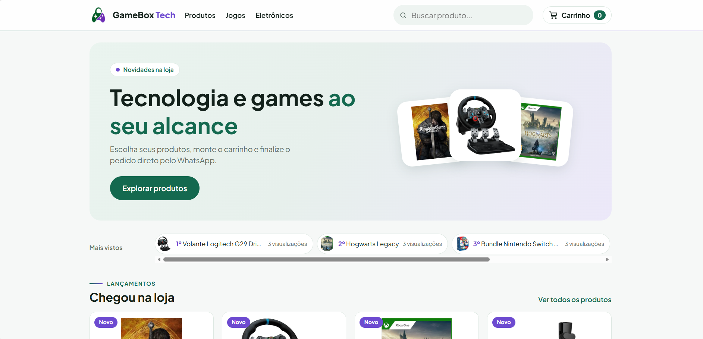
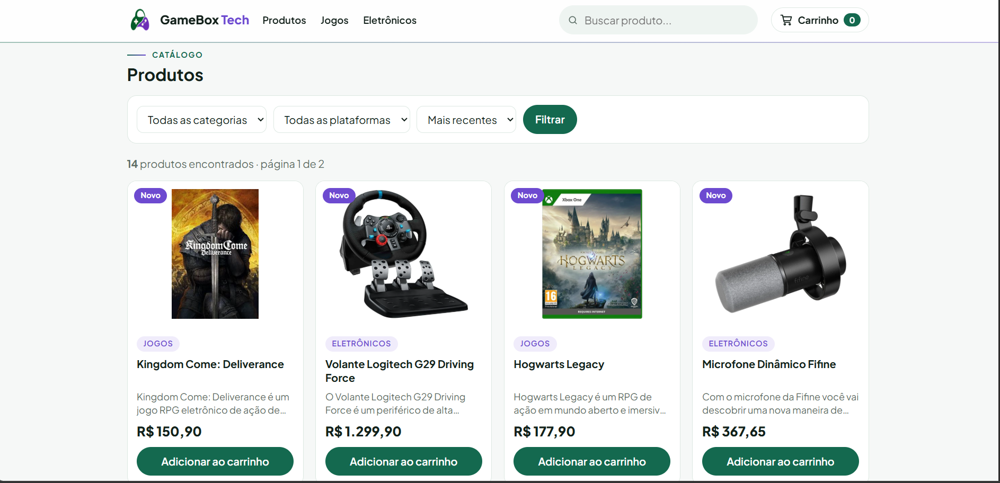
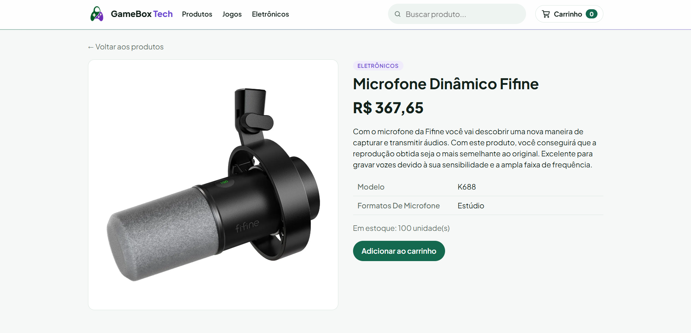
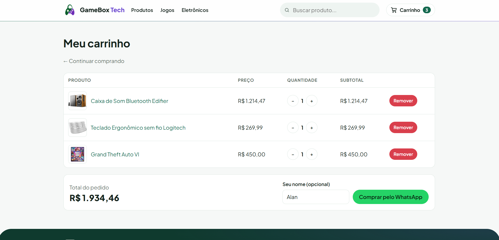
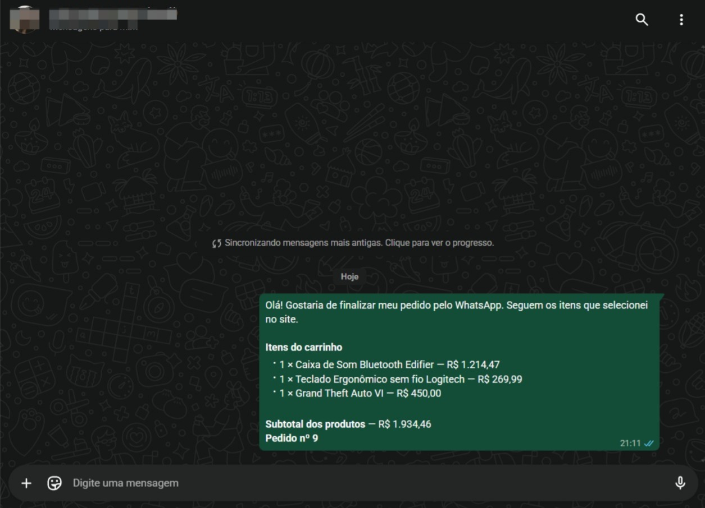
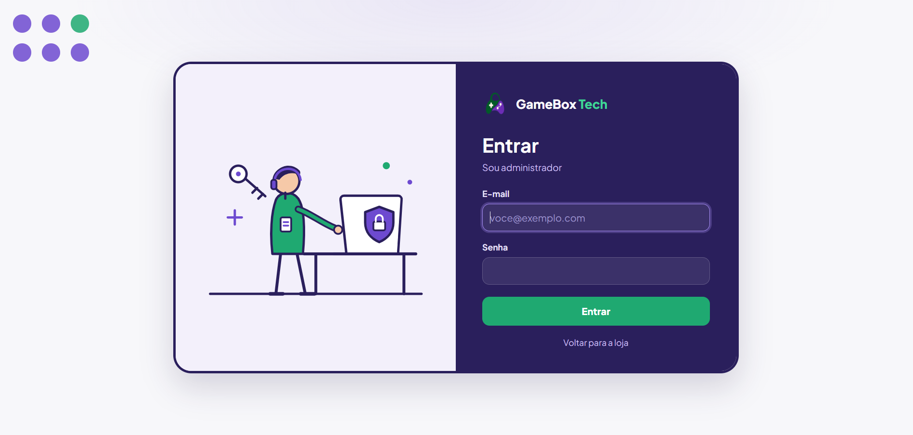
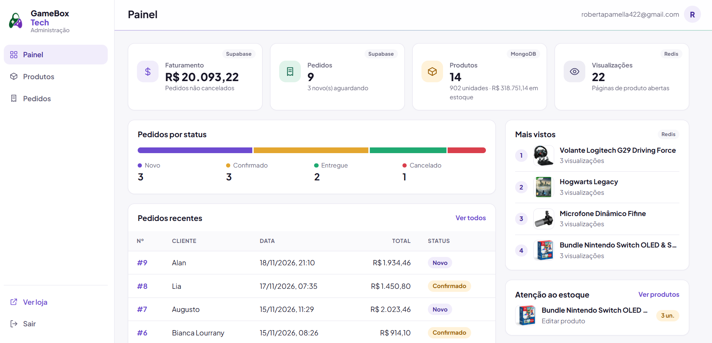
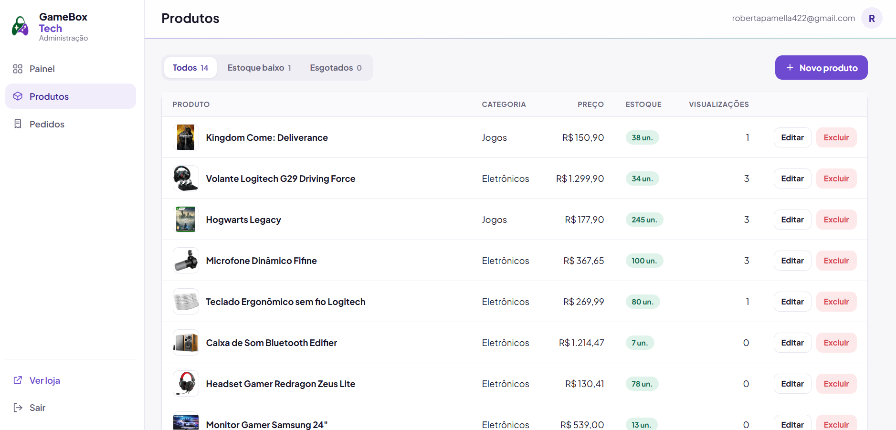
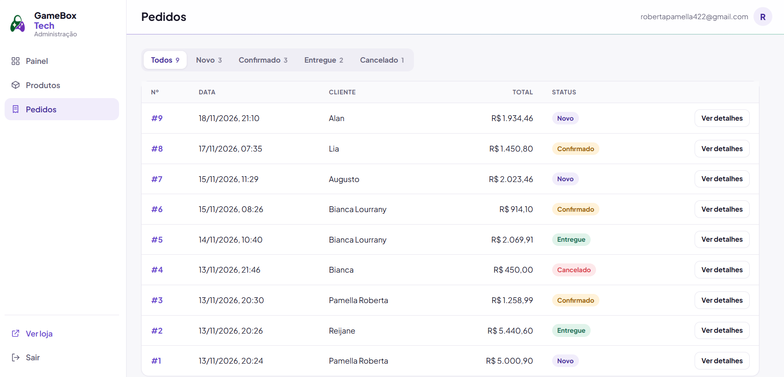

<h1 align="center">GameBox Tech</h1>

<p align="center">
  Loja virtual de eletrônicos e jogos com <b>três bancos de dados</b>, painel administrativo<br>
  e finalização do pedido pelo <b>WhatsApp</b>.
</p>

<p align="center">
  
  
  
  
  
</p>

> Projeto da 3ª Avaliação de **Projeto de Banco de Dados** ( Engenharia de Software, UNIFSA)

> Desenvolvido por Pamella Roberta dos Santos Silva

---

## Telas

<!--
  COMO ADICIONAR OS PRINTS:
  1. Crie a pasta docs/img na raiz do projeto.
  2. Salve cada print nela com o nome indicado abaixo (por exemplo, docs/img/home.png).
  3. Faça commit e push. As imagens aparecem aqui automaticamente.
-->

### Loja

| Página inicial | Lista de produtos |
|:---:|:---:|
|  |  |

| Produto | Carrinho |
|:---:|:---:|
|  |  |

| Mensagem do pedido no WhatsApp |
|:---:|
|  |

### Painel administrativo

| Login | Painel |
|:---:|:---:|
|  |  |

| Produtos | Pedidos |
|:---:|:---:|
|  |  |

---

## Funcionalidades

**Loja**
- Vitrine com os lançamentos, "vistos recentemente" e "mais vistos"
- Busca, filtros por categoria e plataforma, ordenação e paginação
- Carrinho e botão **Comprar**, que abre o WhatsApp com o pedido pronto

**Painel administrativo (`/admin`)**
- Login do administrador
- Indicadores: faturamento, pedidos por status, estoque e produtos mais vistos
- Cadastro, edição e exclusão de produtos (a loja atualiza na hora)
- Lista de pedidos, com detalhe e mudança de status

---

## Por que três bancos de dados

Cada banco guarda o tipo de dado em que é melhor.

| Banco | Função | Por que ele |
|---|---|---|
| **Supabase (PostgreSQL)** | Login do admin e pedidos | Dados com relações e regras rígidas: um pedido tem itens, valores e status controlados por restrições. |
| **MongoDB** | Catálogo de produtos | Cada produto tem características diferentes (jogo: plataforma e gênero; fone: conexão e garantia). Documentos flexíveis evitam colunas vazias. |
| **Redis** | Cache e rankings | Memória rápida, com chave que expira (cache), lista (vistos) e conjunto ordenado (ranking). |

**Como se conectam:** o pedido guarda o `id` do produto (do MongoDB) e uma **cópia do nome e do preço** da hora da compra, então mudar o preço depois não altera pedidos antigos. O Redis guarda só ids e pontuações; os dados completos vêm do MongoDB. Se o Redis cair, o site continua funcionando, só sem cache.

**Chaves do Redis**

| Chave | Estrutura | Função |
|---|---|---|
| `catalogo:produtos` | texto, expira em 60 s | Vitrine da home. É apagada quando um produto muda. |
| `vistos:<visitante>` | lista | Últimos 5 produtos vistos por visitante |
| `ranking:visualizacoes` | conjunto ordenado | Visualizações de cada produto |
| `contou:<visitante>:<produto>` | texto, expira em 1 h | Evita contar a mesma visita várias vezes |

**Índices do MongoDB** (criados sozinhos ao iniciar): `categoria`, `criadoEm` e `atributos.plataforma`.

---

## Tecnologias

| Biblioteca | Função |
|---|---|
| `express` | Servidor web e rotas |
| `ejs` | Páginas HTML com dados do servidor |
| `express-session` | Sessão do visitante (carrinho e login do admin) |
| `@supabase/supabase-js` | Conexão com o Supabase |
| `mongodb` | Conexão com o MongoDB |
| `redis` | Conexão com o Redis |
| `dotenv` | Leitura do arquivo `.env` |

O `package-lock.json` guarda as versões exatas instaladas, para todos obterem o mesmo resultado no `npm install`.

---

## Como executar

**Requisitos:** Node.js 18 ou superior e contas gratuitas no Supabase, MongoDB Atlas e Redis Cloud.

**1. Baixar e instalar**
```bash
git clone https://github.com/SEU-USUARIO/SEU-REPOSITORIO.git
cd SEU-REPOSITORIO
npm install
```

**2. Supabase**
1. Crie um projeto em [supabase.com](https://supabase.com).
2. Em **SQL Editor**, cole o conteúdo de [`banco-de-dados/supabase.sql`](banco-de-dados/supabase.sql) e clique em **Run**. Isso cria as tabelas `pedidos` e `itens_pedido`, com a segurança (RLS) ligada.
3. Em **Authentication > Users > Add user**, crie o administrador (e-mail e senha, com confirmação automática).
4. Em **Project Settings > API**, copie a **URL**, a chave **anon/public** e a chave **service_role/secret**.

**3. MongoDB Atlas**
1. Crie um cluster gratuito (M0).
2. Em **Database Access**, crie um usuário com permissão **`readWrite` somente no banco `gamebox`**.
3. Em **Network Access**, libere o seu IP.
4. Em **Connect > Drivers**, copie a string de conexão (troque `<password>` pela senha).

O banco, a coleção `produtos` e os índices são criados automaticamente.

**4. Redis Cloud**

Crie um banco gratuito e copie o endereço (host), a porta e a senha.

**5. Arquivo `.env`**

Copie o modelo e preencha com os seus dados:
```bash
cp .env.example .env
```

| Variável | O que é |
|---|---|
| `SUPABASE_URL`, `SUPABASE_ANON_KEY`, `SUPABASE_SERVICE_KEY` | Dados do projeto Supabase |
| `SESSION_SECRET` | Texto longo e aleatório que protege o login |
| `MONGODB_URI`, `MONGODB_DB` | Conexão e nome do banco (`gamebox`) |
| `REDIS_HOST`, `REDIS_PORT`, `REDIS_PASSWORD` | Dados do Redis Cloud |
| `WHATSAPP_NUMERO` | Número que recebe os pedidos: só dígitos, com país e DDD (ex.: `5586912345678`) |
| `PORT` | Porta do servidor (opcional, padrão 3000) |

**6. Rodar**
```bash
npm start
```
- Loja: <http://localhost:3000>
- Painel: <http://localhost:3000/admin> (use o administrador criado no Supabase)

Cadastre alguns produtos no painel. As características seguem o formato `chave: valor`, uma por linha (por exemplo, `plataforma: PS5`).

---

## Estrutura do projeto

```
server.js                 ponto de entrada do servidor
src/
  config/                 conexões com Supabase, MongoDB e Redis
  middleware/auth.js      protege as rotas do admin
  routes/                 loja.js (público) e admin.js (painel)
  services/               regras de cada banco
views/                    telas (EJS); admin/ tem as do painel
public/                   CSS e imagens
banco-de-dados/           script SQL do Supabase
```

---

## Segurança

- O **preço nunca vem do navegador**: o carrinho guarda só ids e quantidades, e o preço é lido do MongoDB.
- Valores em dinheiro são calculados em **centavos** (inteiros), sem erros de arredondamento.
- A senha do admin é verificada pelo Supabase Auth e nunca é guardada no projeto.
- As tabelas de pedidos têm **RLS ligado e sem políticas**: só o servidor, com a chave `service_role`, lê e grava. Essa chave fica só no `.env`.
- A busca trata o texto digitado como texto comum (caracteres especiais são escapados).
- O usuário do MongoDB só tem acesso ao banco do projeto.

## Limitações conhecidas

- O pedido é gravado em duas etapas, **sem transação única**. Se a segunda falhar, o pedido é apagado pelo código.
- A compra **não baixa o estoque**: o pedido é combinado pelo WhatsApp e o estoque é ajustado no painel depois da confirmação.
- A busca ignora maiúsculas, mas **diferencia acentos** (buscar "eletronico" não encontra "eletrônico").
- O login não limita tentativas e os formulários não usam token anti-CSRF.
- Não há pagamento online nem e-mail: o fechamento é feito pelo WhatsApp.

## Testes

A lista de testes manuais usada na validação está em [TESTES.md](TESTES.md).
